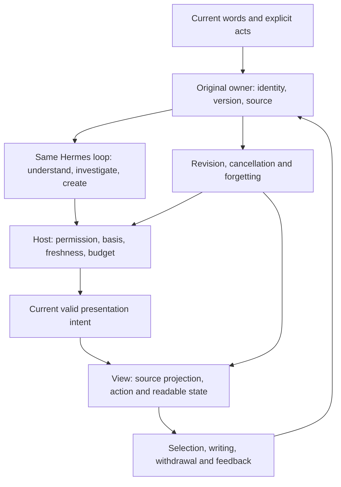

# One companion, the same work, a continuing response

This is Anima's shared frontend/backend **design and implementation contract**. It distinguishes existing seams from proposed contracts and does not certify that every behavior below already runs. Use the [roadmap](../DEVELOPMENT_ROADMAP.md), [visual specification](../../FRONTEND_DESIGN.md), [motion production](CHARACTER_MOTION_PIPELINE.md) and [current status](../CURRENT_STATUS.md). Original objects and current schemas take precedence over convenient new design names.

## 1 · Experience principles with observable consequences

| Principle | Meaning | What would demonstrate it |
| --- | --- | --- |
| Closeness has content | Conversation, affection, excitement, mischief and rigorous work can all belong here. | The companion follows the actual sentence, contributes a useful idea with taste and permits company without a task. |
| Understanding can change | Exact words, conditions and current corrections matter more than profile labels. | “Not that line” changes explanation, pointing, affected proposals and in-flight work, rather than only adding an apology. |
| Take on real preparation | Within granted scope, discover tools, investigate, make content and choose a useful moment. | An offered route can open and an offered draft is actually editable; more notifications are not the measure of care. |
| Personality informs judgment and craft | Characters may notice and make different things. | One notices a missing condition, another builds an elegant explanation; difference exceeds a name or speaking speed. |
| Continuity belongs to objects | Pages, days and devices can carry the same matter. | Original source, auxiliary line, trial arrangement, revision and stopping point remain identifiable. |
| Responsiveness is reciprocal | Typing, a new selection, receiving, pushing back and turning a page change participation. | No waiting for an old performance, stolen camera or queued expired joke. |
| Quiet is complete | Objects and a recovery entry remain available without constant activity. | Silence neither diagnoses a feeling nor cancels an explicit reminder or deletes work. |
| Beauty and truth coexist | Art, sound and light cannot promise a result that does not exist. | Saving follows a real receipt, unaccepted work remains trial, and a physical explanation follows its computation rather than a video. |

Presence means that the person feels a particular companion has understood the matter in front of them. Expressive fiction can be vivid; real services, perception and actions follow actual capability and evidence. Give the character short positive participation guidance and full useful facts rather than injecting this entire engineering contract into every system prompt. Warmth includes ambition, disagreement, excitement, play and unproductive time, not a compulsory comfort route.

## 2 · A line through every surface

A selected PDF sentence can become an original-source slip beside a draft, a chosen reading item in an arrangement, or a return point while going out. The visual form changes; original identity/source does not.



This is not a second agent loop. `harness.ts → runtime/hermes.ts → runtime/hermes/sidecar.py →` the pinned AIAgent remains the primary chain. Memory retains its owner; native `memoryInquiry / recall_experience` investigates permitted originals rather than becoming another store. Notes, materials, agenda, study, activity, works and preparation retain their original authorities.

### Five relations of shared work

1. **Looking together:** an explicitly selected original passage, figure, place or occurrence. Another device does not automatically follow its scroll.
2. **Carrying:** an object or related group the person intentionally hands over for cross-page use. Preserve two comparison papers/routes and their relation, not unrelated red-dot inbox items.
3. **Changing together:** suggestions and operation groups on existing objects, with user and assistant contributions distinct and partial acceptance possible.
4. **Putting aside:** a stopping point, question, draft and optional next step. Having no next step is valid and creates no debt.
5. **Keeping together:** a wording, mark or version relation actually adopted/agreed on. A model-proposed nickname, joke or conclusion is not automatically shared memory.

Map to existing SourceBookmarkReference, SceneSnapshot, CompanionThreadCue, Work and ProgramLocalState as appropriate. The relation layer stores necessary links and recovery information, not copies of every body's text in a universal object table.

### Every real function can be understood

The same primary model receives the current readable object, selection, relationship, unfinished action and usable continuation. It can investigate through the owner, use tools, create, challenge and revise. A page is not a wall the assistant cannot see beyond, and a page label is not a reason to dispatch fixed dialogue.

Focus may be a related group: two equalities, an old/new attempt or two routes. Update local selection, pen and gesture immediately. Only meaningful stable changes, explicit handoff or sending carry needed semantics into the loop; do not await a model for each pixel or send every key. Personality, current words and actual materials inform understanding before any optional performance.

| Surface | Context for the same assistant | Where a response returns |
| --- | --- | --- |
| Cover/conversation | Current conversation, indicated message, related objects and the boundary of unsent writing. | Same composer and result anchor, not a fresh conversation. |
| Study/materials/PDF/notes | Original versions/ranges, two-object relation, user attempt and comparison layout. | Original page/draft; neighboring-text reading, correction, local co-editing and raw pen preservation. |
| Agenda/campus sources | Chosen occurrence/window, trial versus adopted, actual course/record reference. | Original agenda/source owner; understand why something moves without calling a trial saved. |
| Map/activity | Selected/comparison routes, camera ownership, purpose, lawful samples and stop. | Same map/activity record and an actual outing thought beside the original problem. Virtual companion graphics differ from position. |
| Programs/story/piano | Actual version, send-time exploratory values, authorship, local edits and real playback state. | Same creation, retaining both sent snapshot and later input during waiting. |
| Letter/curiosity/preparation | Original invitation/letter/material, relevant source, why useful now and known delivery/exposure. | Reply at that useful object, not a new source-free concern. |
| Persona/appearance/theme/settings | The opened setting, explicit selection, saved versus previewed value. | Same control/configuration, without treating appearance as personality/permission or exposing credentials. |
| Return/folding/wait/failure/new small view | Current object, unfinished operation, honest unknown/invalidation and continuation. | Same draft/focus; new surfaces include context and return semantics. |

Current `focused_work` in context and `currentNote/currentAgenda/currentMapRoute/currentStudy/currentInteractive` in the coordinator are real starting seams, with exact types to inspect before extension. Preserve current group/relation/question/phase/reference/revision/stop. Resolve screen rectangles in the frontend. Whole-product understanding is not unrestricted desktop observation: source read/transfer permissions remain per item, missing material uses real tools, and an old draft requires actual reading rather than a title or thumbnail.

### Three independent times and clocks

| Time | Authority | Consequence |
| --- | --- | --- |
| Fact | Domain source, actual write and explicit user record | Effective course time, saved result, submitted cancellation. |
| Interaction | Current device manipulation/view | Current drag, typing/IME, pen, cancel or target leaving view. |
| Performance | Controlled presentation and actual assets | Eyes first, hand later, paper settling or pausing. |

Ready content is usable immediately, without waiting for a handoff gesture. An animation callback never submits business; cancelling animation does not undo an already committed write. Explicit stop uses the original run/tool cancellation, not just a hidden character.

Use monotonic in-process time for gesture/animation intervals and declared-zone fact time for arrangements/reminders/source validity. Reestablish a monotonic base after restart. Position, weather, calendar and current wish retain separate acquisition/event/applicability times; one global fresh flag cannot renew them all.

### Persona, relationship and private history

An explicitly saved role, relationship and address are configuration; pausing chat memory does not clear them or turn the companion into an anonymous service voice. An inferred name/joke from now-restricted chat cannot disguise itself as configuration to remain usable. Preserve provenance/version of each agreement. Outfit changes appearance; a new role governs future expression; old messages keep their original actor/persona version.

After a role edit, recheck unpublished reply, queued speech, notification preview and cues. Do not let audio keep an old address while text changes, or relabel all old messages as the current person. The effective context actually sent to the model matters, not merely a correct-looking settings page. Trace conflicting defaults and prompt precedence instead of adding a second warm-rewriting model.

## 3 · Six complementary ways to appear

The following are design commitments and alternatives to compare in one actual task, not six static pictures claimed to have won a usability comparison. Inspect discoverability, obstruction, continuation and interruption. Give forms appropriate priority without deleting five because an edge light was implemented first.

| ID/form | Useful situation | Required control and open judgment |
| --- | --- | --- |
| AP1 · Bookmark/paper corner | Shows a real part of the current question; an old attempt may be revealed and released. | Discoverable click/keyboard operation, not a secret long press. |
| AP2 · Object-side line/pointer/short note | A formula, route segment or A/B relationship. | Exact source, distinct companion/user pointers and retiring emphasis; not permanent mouse chasing. |
| AP3 · Shared small desk | Derivation, planning, revision and interactive creation on one original. | Local takeover, one-stroke acceptance and efficient repeated edits without re-unfolding a ceremony. |
| AP4 · Content-bearing compact entry | Folded symbol/route arc/two-draft relation/unfinished bar across pages. | Orb, portrait, paper corner, tray or window can carry it. Stable, foldable and not centered over active work. |
| AP5 · Sound with little glanceable content | Walking, running or hands-busy use. | Real pause/end/status and source remain available; a glow cannot carry all measures or control. Lock-screen behavior follows actual platform conditions. |
| AP6 · One light response | Call, turned attention, response, waiting and return to her own activity. | A stable entry can offer both gentle call and explicit expansion in a discoverable way; no required task selection. |

The same character, conversation and object group continues through them. Formula-side attention can unfold two papers, fold with the actual equality, carry a phrase during an outing and return to the original question. Forms need not compete simultaneously. A light call through the current Harness must not consume/send/clear the unsent draft; its semantics differ from character-initiated check-in.

## 4 · Thin presentation intent, full meaning

The model freely understands the person's words. Supply a small object-bearing intent when performance is useful; the host checks versions/sources and the frontend chooses a supported action. Do not add serial emotion-classification, pose-classification and animation agents.

The following is a **proposed mapping example**, not a currently supported IPC schema:

```ts
interface PresenceCue {
  schemaVersion: 1;
  cueId: string;
  runId?: string;
  messageId?: string;
  sceneInstanceId: string;
  actorInstanceId: string;
  personaRevision: number;
  appearanceVersion: string;
  kind: 'attend' | 'yield' | 'offer' | 'expand' | 'release' | 'resume' | 'play';
  target?: { owner: string; objectId: string; revision: number; anchorId?: string };
  basisIds: string[];
  status: 'proposed' | 'ready' | 'committed' | 'failed' | 'unknown';
  epoch: number;
  validUntil?: string;
  invalidatesOn: string[];
  interrupt: 'retarget' | 'release-and-yield' | 'discard';
  fallback: { text?: string; staticState: string };
}
```

Map owner/target/basis to the actual concrete source unions rather than accepting arbitrary strings as authority. The host checks actor against current role, scene against allowed presentation, owner/version, purpose, epoch, expiry and asset capability. Client-supplied status/source/success/permission proves none of them. Keep existing CompanionActivityHint compatibility. Extending activity into object-bearing cues must not read keywords to decide that the person is sad.

Seven reusable stage grammars map **attend/look, yield, offer, expand/unfold, release/retract, resume and play**. They are not seven life intents, seven personality responses or a tool-visibility classifier. A corrected pointer can release→attend; putting down a pen after a fact can release→settled. Ordinary answers remain natural without a cue.

A presentation might follow eligible→preparing-view→entering→holding→releasing→settled, with discarded on invalidation, yielding on input or static on resource failure. That is not the business-success machine. Same-topology targeting can redirect from current pose/velocity; a new contact topology releases safely first. Typing clears obstruction and optional invitations while keeping results. Scroll retracts unreliable pointing until a still-valid selection settles. Revocation immediately hides affected text/image/thumbnail/speech/target and cancels queues—elegant withdrawal cannot justify showing restricted material longer. Hidden time stops decoration and returns from current state, never accumulated greetings. Missing art uses a qualified same-character static or the person's no-character choice, never a substitute character or wrong figure.

## 5 · Body, gaze, paper and sound cooperate

| Channel responsibility | Rule |
| --- | --- |
| Body root/support | A compatible calibrated support governs the body; translating the whole figure vertically is not breathing. |
| Eyes/head | Current shared target first, with a possible small head delay. No default mouse tracking or interpreting dwell as confusion. |
| Hands/props | One effective driver during contact; assets unable to release cannot claim interruptible handoff. |
| Face/brows | Character-appropriate expression within a qualified range, never a user-emotion fact. |
| Mouth/speech | Actual audio lifecycle drives lip motion. No audio means no claim something was spoken or heard. |
| Paper/layout | Original-object view and direct manipulation; text/numbers stay clear while decoration is separate. |
| Light | Whole scene atmosphere, not flashing each token. A rainy choice is an atmosphere. |
| Sound | Coherent restrained mixing and independent controls; avoid the same event sounding on several devices. |

These are responsibility names, not proof same-named controllers exist. Priority for contention: **withdrawal/explicit cancel → direct input/manipulation → necessary information and agreed reminder → current object-bearing participation → optional play/ambience**. This arbitrates a channel, not human life values, and unrelated usable semantics must not disappear.

### Initial action studies

The times below are candidate tuning intervals, not psychology, response SLAs, exact generation controls or delays before useful content. Tune on actual devices.

| Cause/action | First study | Interruption and resolution |
| --- | --- | --- |
| Look at a real line | Eyes roughly 120–220ms, then a small head change roughly 180–320ms; any hand stays outside text. | New selection retargets; scroll retracts; without anchor show the actual selected source instead. |
| Place a ready result nearby | Content appears immediately; a roughly 180–300ms edge move may place it in the stable result area. | Reading makes the character withdraw; result remains. Closing does not cause another offer. |
| Yield to writing | Hand withdraws before reducing visual emphasis; large layout need not move with every key. | Keep a quiet compatible seat after the stroke; do not crowd back automatically. |
| Correct a mistaken pointer | Wrong emphasis stops immediately; a brief withdrawal precedes a confirmed new target. | No valid target means stop, not a head-scratch loop or completed-apology delay. |
| Return a bookmark | Actual page appears through its stable entry; attention can move bookmark→person. | No automatic page turn; doing something else puts it quietly aside without questioning the absence. |
| Put the pen down | A real end/result is acknowledged immediately, with optional hand/shoulder settling. | Undo updates fact immediately; renewed work does not replay celebration. |
| Receive a joke | A related actual bookmark/action may produce a press/edge lift/glance/acceptance, with valid causes at each turn. | Typing/page change yields; a cancelled joke never queues for later. |

Sakiko may settle a paper before releasing it; Taki may be brisk; Tomori may inspect her mark first; Rāna may linger at a paper curl. These are original directions, checked against complete passports and user configuration rather than fixed facial/interest jobs.

Long stable holds matter. Do not animate gaze, breathing, hair, light, gradients and particles all at once in a reading surface. Timely accurate response is more useful than constant movement. Springs can keep direct-manipulation velocity, reveals can ease and scientific motion uses its calculation clock. Support/collision and exact pointing do not overshoot; visual `useSpringValue` does not become a business clock.

### A related family of sounds

Paper, light touch and wood can start a small coherent sound vocabulary; this is neither exactly three required samples nor a ban on refinement. Receiving/settling/withdrawing the same object has related material and direction, with subtle variation rather than identical repeated playback. Tune by actual speed/distance and hear the target device. Voice/music yield channels to one another. No default typing sound or invented dB guarantee. Unknown outcomes do not get a business-success sound. A physical paper settling is not itself proof of a saved action. Mute remains complete; diagnostics never join the finished soundscape. Stage 06 establishes the related language, 09/10 connect real instrument audio, and 11 checks a single event does not play twice during device handoff.

## 6 · Feedback enters cooperation without surveillance

Send necessary current semantic observations, not a standing feed of pointer moves, each frame, keystrokes, unsent drafts or desktop screenshots. Intermediate drag stays local; commit, cancel and meaningful stop can become an event. Incomplete IME composition is not an authored message.

| Observation | What it establishes | What it does not establish |
| --- | --- | --- |
| selection.changed | The explicitly chosen object/range. | Reading, understanding, confusion or liking. |
| interaction.editing | This area needs room now. | Diligence, anxiety or fatigue. |
| proposal.accepted/declined | A decision on this proposal. | Permanent liking/dislike of the character. |
| object.changed | Actual owner-committed new version. | Every word is the person's belief or correct. |
| presentation.visible | A viewport presentation. | Seen, understood, accepted or executed. |
| resume.requested | A wish to resume this stop. | Every old goal/approval reactivated. |
| quiet.requested | This explicit current quiet scope. | All entrusted work/fixed alarms cancelled. |
| cue.interrupted | This action stopped for a concrete act. | Rejection of the companion or content. |

Use event/device/conversation identity, original version, reason, time and applicability. Necessary observations follow the main chain, not model inference for every gaze. Adaptation uses sourced feedback rather than a hidden emotion score trained from silence or dwell.

Generation, saving, delivery, viewport exposure, actual audio, reported reading, understanding, adoption and real completion each need their evidence. Missing receipt is unknown, not “unread” followed by resend. Long-text partial display and skipped audio preserve confirmed ranges; a maximum character cursor does not prove preceding exposure. The product need not show this bookkeeping, but later speech cannot claim everything was explained when only the beginning played.

Original text anchors use owner content version and Unicode code points. Convert DOM UTF-16 explicitly. Repeated text is not located by first `indexOf`. If an original cannot be verified, preserve an appropriate reference/recovery entry and reanchor; never confidently point at the wrong line.

## 7 · Seven creative responsibilities and recovery

### G1 · Shared pointing and correction

Tie the real target or A/B relation, explanation symbols and original source together, with separate user/companion pointers. Correction changes usable context, dependencies and actual help as well as the view. Retire stale targets and let necessary original/neighboring-text reading continue. A highlighted rectangle alone is incomplete.

### G2 · Old and new understanding recognize one another

Actually reread the old draft, conditions and person's words, then describe correspondence, difference and changed premise. An earlier rotation sketch and current complex exponential need a real relation. Let the person move or deny a pairing and revise the explanation. Overlay only where spatial registration is defensible; paired pointing serves different expressions of a variable, while plan/outing or concept/full model can compare side by side. Visual likeness is not conceptual equality, and difficult overlay does not justify deleting the connection.

Restore both original versions/stops, A/B roles, selected mapping, relative placement, current question and local layout, not only a page number. Desktop can recover that workbench; narrow layout can use linked switchable pages. Current single-object `workspace-return.ts` is a foundation, not evidence of complete comparison-group recovery. Cross-device sync carries relation and stops; focus/exact pixels stay local.

### G3 · Turn-taking on the same object

Auxiliary lines, relation annotations and explanation references can share an operation group with base revision and authorship. Accept one stroke; reject the rest without erasing later user work. A moved dependent vertex invalidates the old suggestion for recomputation or repositioning. Undo is not an entire-database rollback. Historical viewing is read-only; trying a past version creates a new draft rather than silently rewinding the current shared object.

### G4 · Carry the matter across pages

Give each common surface a predictable invocation: perhaps a paper edge on desktop and the existing toolbar on narrow screens. Stable means discoverable and nonobstructive, not the same pixel at every breakpoint or a permanent floating island. Show a small meaningful part of the current work rather than tasks, counts, mood and logs at once. Preserve the object group and valid gesture; incompatible support, target change or input safely releases from the current state. The same original draft and input remain.

### G5 · Personal marks retain their craft and reason

Support presets and real user strokes/shapes/names, including an imperfect star, with editable versioned appearance and original meaning references. A narrow-path reason can inform the same route and a later arrangement, rather than just pop up a repeated memory. Marks are sparse, reachable by click/keyboard and return to context. Name, drawing, position and removal keep an owner. A suggestion remains trial until actually adopted/agreed; one dislike is not a permanent strategy. Removing a mark, correcting meaning and forgetting its source propagate at their distinct scopes and grant no action permission.

### G6 · A taskless call can end

Receive the call, turn attention from her own activity, respond, wait naturally and return if appropriate. Waiting depends on scene/new input, not a three-second mood judgment. A greeting need not start work or analyze silence. Hidden/no-art modes preserve tools, objects, return and saved agreements. Ordinary private activity such as blinking or turning a page can have its own life reason without a transaction receipt.

### G7 · Jokes remember the exchange

A note tilted/straightened, another glance and a later crooked pencil illustrate causality, not a fixed third-click reward. Immediate feel stays local; relevant recent acts and explicit feedback let the same character choose a reply, different play or quiet. No per-frame inference or fixed three-turn amnesia. Use a joke only while it fits and does not touch active work. Writing yields, pushback is received and interruption stops. A genuinely liked action can occasionally return with varied interval/context, not forever. Silence is neither liking nor refusal.

### Invalidation, notifications and preparation

Block affected source use before cleaning retrieval, plan basis, pending delivery, cues, captions, audio caches and recovery thumbnails. Independent accepted calendar objects keep their own basis and requested scope. Current consumers reject late old work through the real epoch/fence; an offline device checks it before content on reconnect. Do not promise instantaneous offline knowledge. Reliable local changes use existing transactions/outbox and deduplicate cue/object versions. A host knows intent delivery, not viewport presentation without that receipt; viewport presentation still does not prove understanding. Diagnostic metadata does not become a permanent behavioral profile.

Preparation, a message and a notification are distinct projections of the same matter with their own IDs/versions. Opening notification returns to the exact message/object, not new source-free care or a duplicate action. OS acceptance is not human exposure; retrying a preview does not repeat business. Effective persona supplies its signature, and lock-screen disclosure is limited to its allowed audience. Return to original content without reading the notification in full again.

“Quiet today; keep the eight o'clock reminder” contains two choices. Optional invitations recede while the independently agreed reminder stays due within the host's actual lifecycle. Quiet scope has an end condition; elapsed time means recheck, not regained energy or renewed acceptance. A stopped process/sleep or paused external schedule is no promise of continuing service.

## 8 · A complete outing and eight fine details

### One before–during–return story

**RUN1:** retain whether this is a genuine institution-backed aim or simply fresh air, without importing an unverified rule. Before leaving, prepare the same real route/purpose and original question's return point. **RUN2:** start lightly, then leave sound/breathing/quiet room; “be quiet” stops optional speech and “talk now” rechecks relevance. A compact form retains pause/end and glanceable source quality. **RUN3:** an interrupted half-phrase remains an editable original thought attached to the same problem; no ASR/device capability means no false capture claim. **RUN4:** actual state comes only from lawful observation/self-report with its quality. Do not invent missing heart rate, calories, pace or official recognition. End or slow down naturally; early return is no failure. **RUN5:** back at the same desk/problem, the actual retained phrase, route and local result remain available. Official acceptance requires its provider's same-attempt receipt; returning to a proof is not mastery. Do not split this into three visually pleasing but disconnected demonstrations.

| Detail | Obligation |
| --- | --- |
| DT1 · Beautiful interruption | Typing, pen or a new topic immediately takes over the old goal without losing IME, focus or draft. |
| DT2 · Placement remembers | Comparison relation, both versions/stops and useful local geometry survive together. |
| DT3 · Related sound | Receive/place/retract/summon share material and direction with variation; mute preserves all control. |
| DT4 · Useful return changes | Highlight only actual relevant changes, with local old/new comparison and natural dismissal. No changes means simply continue. |
| DT5 · Ready where useful | Example beside the problem, route near departure and old draft at comparison; the actual material can be retrieved and used. |
| DT6 · Motivated life | Shared actions have reasons and characters can have their own quiet interests. No compulsory business reason for every blink. |
| DT7 · A natural ending | Early stop, “I will look on my own” and no-task departure preserve what matters without punishment or guilt. |
| DT8 · Humor has space | Remember real context/feedback, appear occasionally if appropriate and permit absence without a reward schedule. |

An afternoon spent only on a strange story, piano keys or clouds can be complete. Familiarity must not imprison a person inside recorded interests. Reuse original curiosity matter/options and actual shared-creation reading. Full old chapters in Scene do not disappear because ordinary message text is empty. Continue the actual chapter/version or create a chosen new branch, without turning play into a task, calendar item or lasting profile.

## 9 · Accessibility, low resources and honest fallback

System/app reduced motion applies during operation and immediately stops nonessential motion. Shared selection, readable results, correction and return retain a complete static equivalent. Direction/color/face/sound cannot be the only evidence of a result. Hide decorative character content from assistive technology; interactive entries have names and keyboard operation. Results do not steal focus, and non-drag/narrow alternatives preserve meaning.

Geometry and animation do not make model round trips. Show useful content as soon as available. Measure actual input latency, frames, decoding, memory and energy on each target; “CSS at 60fps” is no evidence. Hidden/background/reduced-motion/energy pressure can use qualified static or content-only views. Deployed video needs poster, failure and stop behavior without blocking a task. Multiple actors only occur in a chosen scene, with independent instances/channels/resources; one speaker cannot move every mouth.

Fallback keeps usability; it does not close a required normal gesture, missing asset, complete character matrix or device goal. Formal stages retain their full eight substantive agent responsibilities and primary integration/acceptance, not only one vertical slice.

## 10 · Verify the continuing experience

Use normal entries and relevant existing checks. Inspect actual continuous changes at ordinary speed, not merely endpoints or motion-library imports. Do not write new tests, fixtures, suites or runners without explicit test-development authorization.

| Continuous path | A useful observed result | Failure to repair |
| --- | --- | --- |
| Select source → attend → next line | Correct retarget, old emphasis gone, writing intact. | Old coordinates revive or old animation must finish. |
| Ready result → type during offer → leave/return | Result remains usable, character yields, same object returns. | Content waits for the hand or a new copy replaces it. |
| Suggest line → move premise → retain one stroke | Dependence updates and user work survives. | Stale coordinates or group undo deletes everything. |
| Agenda trial → external change → adopt | Recheck affected interval and update after the real receipt. | Animation reports save or blindly rearranges the whole day. |
| Stop → late result → reopen | Stop remains effective; no expired invitation/speech/success. | Hidden UI masks ongoing writes or replays queued output. |
| Forget → another device reconnects | Fence precedes content, including thumbnails and audio targets. | Text alone disappears while derived material leaks. |
| Reduced motion → keyboard same task | Same object/result/control. | Motion was the only information or operation. |

Also operate taskless calls, causal play, old/current recognition, whole comparison recovery, cross-page personal marks, useful-only return changes and real preparation at use. Record real entry/version, acts, owner receipts, presentation, interruption and limits. A little appropriate motion evidence can show time, but a long checklist, model self-rating or repeated persona dialogue cannot judge the relationship. A correctable in-scope defect is repaired and rechecked; a genuine external condition remains accurately open.

Design research informs this contract rather than proving long-term companionship outcomes. [Apple's fluid-interface session](https://developer.apple.com/videos/play/wwdc2018/803/) discusses responsiveness and mid-gesture redirection; [ELEGNT](https://machinelearning.apple.com/research/elegnt-expressive-functional-movement) explores functional and expressive robot motion. Neither validates Anima's exact timings or long-term effects. [W3C's animation guidance](https://www.w3.org/WAI/WCAG22/Understanding/animation-from-interactions.html) informs disabling nonessential interaction motion. [tldraw's agent example](https://tldraw.dev/starter-kits/agent) offers structured canvas/action ideas, and [Patchwork's branch-based suggestions](https://www.inkandswitch.com/patchwork/notebook/2024-version-control/07/) inform reviewable partial adoption. The object/character/permission contracts here are Anima design decisions that still need their actual implementation evidence.
